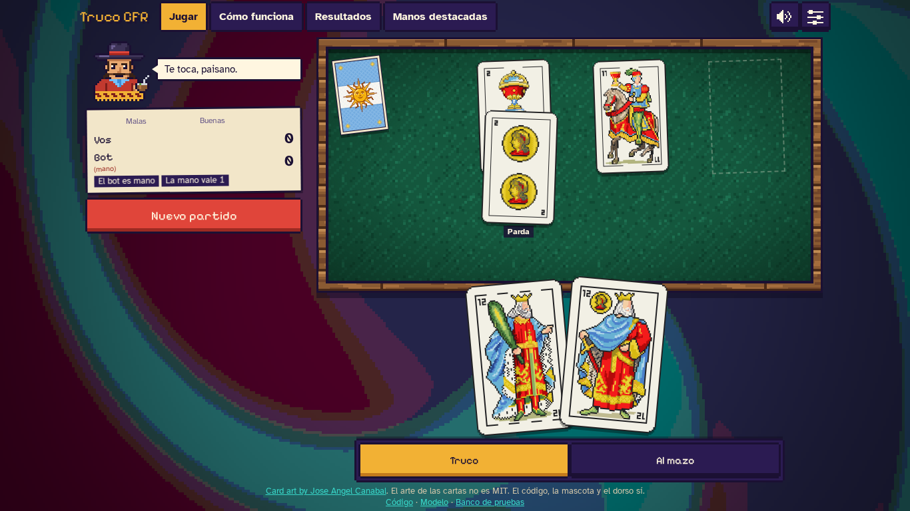

# Truco CFR

An AI that learned to play (and bluff at) Argentine truco by playing against itself. Runs entirely in your browser.

Play: https://tomzvilla.github.io/truco-cfr/ · Model: https://huggingface.co/tomzv1/truco-cfr



## Results

Full matches to 30, duplicate format (each deal is played twice with the seats swapped, so card luck cancels out):

| Opponent | Matches | Bot wins | 95% Wilson CI |
|---|---|---|---|
| Random legal moves | 2000 | 90.9 % | [89.6; 92.1] |
| Hand-written heuristic | 2000 | 63.4 % | [61.3; 65.5] |
| Claude Haiku (LLM reading the table as text) | 100 | 59.0 % | [49.2; 68.1] |

It learned to bluff: it calls envido with 7 points or less in 38 % of those hands, and 17 % of its truco calls
come with a hand in the weakest 30 % (the heuristic: 0 %). The Haiku sample is small, so that edge is not
conclusive. Full report: [docs/eval-report.md](docs/eval-report.md).

## How it works

Deep CFR (Brown et al., 2019) in plain words: the bot plays millions of hands against itself and, at every
decision, writes down how much it "regrets" not having taken each of the other options. A neural network learns
to predict those regrets, and the next round of self-play uses its predictions. The average strategy over all
rounds converges to an approximate Nash equilibrium, which is why it bluffs in the right proportion: a player who
never bluffs is easy to read. No human games, no language model, no fine-tuning.

The game engine is written in Rust and shared by the training code (through PyO3) and by the web app (compiled
to WebAssembly), so the bot you play in the browser runs the exact same code that trained it. Training took
about 7 hours on one RTX 5070 Ti. The web app is fully static (no servers, no API keys), so it costs nothing to host.

## Cómo funciona (en español)

Deep CFR, en criollo: el bot juega millones de manos contra sí mismo y, en cada decisión, anota cuánto se
"arrepiente" de no haber elegido cada una de las otras opciones. Una red neuronal aprende a predecir esos
arrepentimientos, y la siguiente tanda de partidas usa lo que aprendió. La estrategia promedio de todas las
tandas converge a un equilibrio de Nash aproximado, y por eso farolea en la proporción justa: el que nunca
miente es fácil de leer. No usa partidas humanas, ni modelos de lenguaje, ni ajuste fino.

El motor del juego está escrito en Rust y lo comparten el entrenamiento (con PyO3) y la web (compilado a
WebAssembly): el bot contra el que jugás en el navegador corre el mismo código con el que se entrenó. El
entrenamiento llevó unas 7 horas en una sola RTX 5070 Ti. La web es estática (sin servidores ni claves), así
que alojarla no cuesta nada.

## Repository layout

| Path | What it is |
|---|---|
| `engine/` | Truco rules, encoding, MLP forward pass and CFR traversals (Rust) |
| `engine-py/` | PyO3 bindings used by the training code |
| `engine-wasm/` | WebAssembly build of the engine and the data generator for the web pages |
| `train/` | Deep CFR training in PyTorch, configs and the weights exporter |
| `eval/` | Tournament, bluff analysis and highlights (`truco-eval`) |
| `web/` | The static web app (React + Vite) and its tests |
| `models/` | The trained strategy network (`strategy.tcfrw`) |
| `hf/` | Model card and config for Hugging Face (weights are generated, not committed) |
| `docs/` | Evaluation, training and benchmark reports, weights format |

## Reproduce

```bash
# tests
cargo test
cd web && npm ci && npm test

# build the WebAssembly package
scripts/build-wasm.sh

# train (about 7 h on a GPU)
cd train && uv run python -m truco_train run --config configs/overnight.toml

# evaluate: see the commands at the end of docs/eval-report.md

# real data for the web pages
cargo run --release -p truco-engine-wasm --bin web-data

# export the model (safetensors + ONNX) and check parity across PyTorch, Rust, ONNX and WASM
cd train && uv run python scripts/export_hf.py
```

For the Python side, install in this order: `uv sync`, then
`uv run --no-sync maturin develop --release -m ../engine-py/Cargo.toml`, then `uv run --no-sync ...`
(`uv sync` removes the engine bindings, so they are built after it).

## Credits and license

Code and weights: MIT ([LICENSE](LICENSE)). Card art by Jose Angel Canabal: it is **not** MIT, see
[web/public/cards/LICENSE-ART.md](web/public/cards/LICENSE-ART.md) and [NOTICE](NOTICE). Fosfo (the mascot) and
the card back are original to this project.
